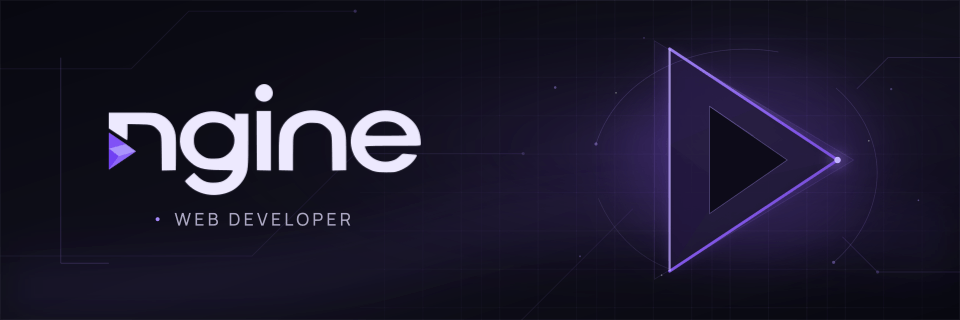

  

<h1 align="center">Hello, moi c'est amnesiann ✨</h1>

  <strong>NGine · Création de sites web · Services informatiques</strong> 
  Des idées, du code et des projets qui prennent vie ✨

  
  

---

### ✦ Un peu de moi

Bienvenue sur mon profil ! J'aime imaginer et développer des expériences web, soigner leurs interfaces et expérimenter de nouvelles idées. À travers **NGine**, je propose la création de sites web et des services informatiques. Ici, je partage mes projets et mes explorations.

### ✦ Langages

  

**HTML · CSS · JavaScript · TypeScript · PHP**

### ✦ Frameworks & technologies

  

**Vue.js · Next.js · Laravel · Tailwind CSS · Node.js · Vite**

### ✦ Outils & systèmes

  

**Git · GitHub · Docker · Linux · Windows**

---

### ✦ Quelques projets

<table>
  <tr>
    <td width="50%"><strong><a href="https://github.com/nemesiaa/packsmart-nextjs">📦 Packsmart</a></strong> Un projet construit avec Next.js et TypeScript.</td>
    <td width="50%"><strong><a href="https://github.com/nemesiaa/app_contact_nina">💌 App Contact</a></strong> Une application web réalisée avec Vue.js.</td>
  </tr>
  <tr>
    <td width="50%"><strong><a href="https://github.com/nemesiaa/retro_monster_2025">👾 Retro Monster</a></strong> Un projet web autour de Laravel.</td>
    <td width="50%"><strong><a href="https://github.com/nemesiaa/flux-rss-veille-comptable">📰 Veille comptable</a></strong> Des flux RSS pour suivre l'actualité comptable.</td>
  </tr>
</table>

  <strong>Merci pour votre visite ✨</strong> 
  À bientôt ! ✨

